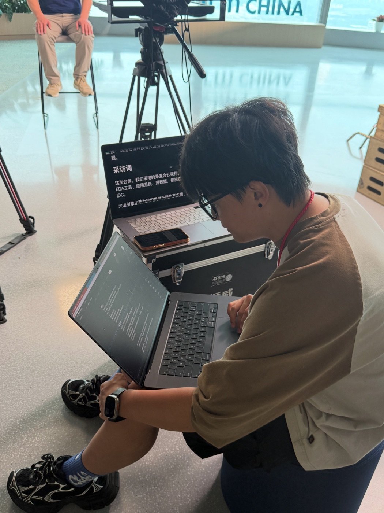

<h1 align="center">庄Sir的提词器</h1>

<p align="center">
  <b>为真实拍摄现场做的本地提词器。</b><br />
  一台电脑写稿、改稿、控稿；任何一块屏幕给出镜者看干净的大字。
</p>

<p align="center">
  <a href="https://github.com/billzhuang6569/zhuang-prompter/releases/latest"></a>
  
  <a href="LICENSE"></a>
</p>

<p align="center">
  <a href="https://bill-api.whatonearth.work/prompter/download/macos-arm64"><b>下载 Mac（M 芯片）</b></a> ·
  <a href="https://bill-api.whatonearth.work/prompter/download/macos-x64"><b>Mac（Intel）</b></a> ·
  <a href="https://bill-api.whatonearth.work/prompter/download/windows-x64"><b>Windows</b></a> ·
  <a href="https://bill-api.whatonearth.work/prompter/download/windows-arm64">Windows ARM</a> ·
  <a href="https://zhuang-prompter-web.vercel.app">官网</a>
</p>

<p align="center">
  
  
</p>

<p align="center">
  <sub>不是演示图，是我在访谈拍摄现场真实使用的样子：手里的电脑控稿，镜头前的屏幕只显示该读的那几行字。</sub>
</p>

---

## 为什么做它

拍过视频的人都知道，提词器最难的从来不是“让文字滚起来”，而是开拍前后那些手忙脚乱的瞬间。

| 拍摄现场的真实问题 | 庄Sir的提词器怎么处理 |
| --- | --- |
| 嘉宾已经坐好了，现场还在改词 | 控制端直接改稿，点「完成」保存，播放端立刻换成新稿 |
| 录到一半要回到某个重录点 | 点一下稿件里的那句话，播放端就跳过去；也可以用标记点一键跳转 |
| 不知道出镜者现在读到哪 | 控制端把播放端正中间那一行字实时加底色，换行就跟着走 |
| 提词器镜像方向不对，临开拍还在调 | 水平、垂直镜像各一个开关，从控制端遥控 |
| 出镜者只想看大字，控稿的人要看备注和标记 | 两端分开显示：播放端只有正文，控制端保留备注、标记和版本 |
| 脚本还没发布，不想传到陌生云端 | 不用登录，不连云端，文稿只存在你自己的电脑里 |

## 三分钟上手

1. 在电脑上打开 App，创建一个房间。一个房间就是一个拍摄项目。
2. 写稿或粘贴 Markdown，需要的地方加上**标记点**（章节、重录点）和**备注**（看镜头、停顿、切画面）。
3. 让播放端连上同一个 Wi-Fi 或热点，在浏览器打开 `play.local:3000` 输入房间号，或者直接扫控制端的二维码。
4. 点「完成」锁定稿件，按播放。剩下的速度、跳段、字号、镜像，都在控制端完成。

播放端可以是另一台电脑、外接显示器、iPad 或手机，只要有浏览器就行，不用装任何东西。

## 它能做什么

### 控稿的人：控制端

- **知道出镜者读到哪**：播放端正中间那一行的字，在控制端实时高亮；字号放大缩小、窗口变化后自动重新对应。
- **点哪播哪**：稿件锁定后，点击任意一个字，播放端就跳到那一行。正在播放就接着播，暂停就停在那里。
- **编辑 / 完成 一键切换**：编辑态随便改；完成态不会误触改字，也不会出现光标。
- **标记点与备注**：标记章节和重录点，一键跳转；备注只给控稿的人看，不会出现在播放端。
- **版本**：现场每次大改都可以存一个版本，随时回退。
- **播放控制**：播放 / 暂停、前进后退一段、回到开头结尾、调速度、调字号（不封顶，远场大屏也够大）、水平 / 垂直镜像。所有跳转都保持原来的播放状态，不会一跳就停。
- **邀请播放端**：好记短链一键复制，或者扫二维码加入。

### 出镜的人：播放端

- 只有干净的大字，自动滚动，可全屏。
- 默认隐藏标记点和备注，出镜者只管读词。
- 支持多个播放端同时显示，设一台为主播放端，其余跟随它。
- 支持防息屏，长时间录制屏幕不会自己黑掉。

### 本地优先

- 不需要账号，不依赖云端数据库，文稿和房间数据只保存在你的电脑上。
- 没有外网也能用：用 Mac 开个热点，两台设备连上就能开工。
- 未发布的脚本不会离开你的设备。

> 还在测试中的**语音辅助**：开启后根据出镜者的语音自动推进稿件，没有声音时自动停下，手动暂停永远优先。

## 下载与安装

| 系统 | 下载 | 安装方式 |
| --- | --- | --- |
| macOS · M 系列芯片 | [下载 .dmg](https://bill-api.whatonearth.work/prompter/download/macos-arm64) | 打开 DMG，拖进「应用程序」 |
| macOS · Intel 芯片 | [下载 .dmg](https://bill-api.whatonearth.work/prompter/download/macos-x64) | 打开 DMG，拖进「应用程序」 |
| Windows · x64 | [下载 .exe](https://bill-api.whatonearth.work/prompter/download/windows-x64) | 运行安装包，之后可在 App 内自动更新 |
| Windows · ARM64 | [下载 .exe](https://bill-api.whatonearth.work/prompter/download/windows-arm64) | 运行安装包，之后可在 App 内自动更新 |

所有历史版本都在 [GitHub Releases](https://github.com/billzhuang6569/zhuang-prompter/releases)，每个版本改了什么见 [更新日志](docs/CHANGELOG.md)。

> **首次打开提示“未知开发者”？** 安装包暂时还没有商业代码签名。macOS 在「系统设置 › 隐私与安全性」里点「仍要打开」；Windows 在 SmartScreen 提示里点「更多信息 › 仍要运行」。

## 播放端连不上？

控制端和播放端需要在**同一个网络**里：同一个 Wi-Fi、同一个手机热点，或同一个办公室局域网都可以。

如果播放端打不开 `play.local:3000`，按顺序检查：

1. 两台设备是不是连在同一个网络上。
2. 个别设备解析不了 `play.local` 时，改用控制端同时显示的 IP 备用网址。
3. 控制端电脑第一次弹出“允许传入网络连接”时，要点允许；Windows 防火墙同理。

更多细节见 [本地网络使用说明](docs/local-network-usage.md)。

## 从源码运行

适合想参与开发，或者想在自己的服务器上跑网页版的人。需要 Node.js 20 以上和 pnpm。

```bash
git clone https://github.com/billzhuang6569/zhuang-prompter.git
cd zhuang-prompter
pnpm install
pnpm build
pnpm start
```

然后在浏览器打开 `http://localhost:3000`。同一局域网的其他设备用这台电脑的 IP 访问即可。

想自己打桌面安装包：

```bash
pnpm dist:mac   # 在 Mac 上
pnpm dist:win   # 在 Windows 上
```

改代码前请先读 [工作区规则](docs/WORKSPACE.md)；打包细节见 [release-packaging.md](docs/release-packaging.md)。提交前跑一遍：

```bash
npx tsc --noEmit && pnpm lint && pnpm test:contracts
```

## 接下来

- 安装包代码签名，去掉“未知开发者”提示
- 更稳定的多播放端同步
- 语音辅助转为正式功能
- 更适合团队协作的项目管理

## 反馈与参与

这个项目会一直围绕真实拍摄现场打磨，而不是变成一个臃肿的通用文档工具。现场用着哪里别扭，最有价值。

- 遇到问题或有想法：[提一个 Issue](https://github.com/billzhuang6569/zhuang-prompter/issues)
- 想直接改：欢迎 Pull Request

## 开源协议

[MIT](LICENSE)。免费下载、使用、研究和改进。
